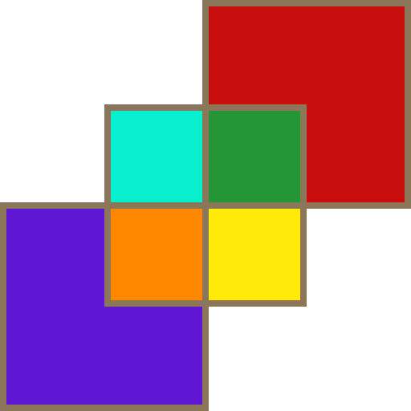

#  mm

Digital version of the [Mastermind](https://en.wikipedia.org/wiki/Mastermind_(board_game)) game.

## Rules

At the start of the game, a secret code is set. Over the course of 12 turns (each represented by a single row on the board), the player attempts to guess the correct code. Each guess is evaluated and the player receives feedback in the form of colored pins. Every pin represents a single code element. There are 3 types of pins:

* **Red** - a correct element is in the correct position.
* **White** - a correct element is in an incorrect position.
* **None** - an incorrect element is present.

A feedback field does not correspond to any particular code field. Pins are placed from left to right, with red pins taking precedence over the white pins.

To win the game, player must deduce the correct sequence within at most 12 attempts.

## Settings

The following table presents configuration options that are available. Some changes require restarting the game to take effect.

| Option                  | Restart | Description                                                                 |
|:------------------------|:-------:|:----------------------------------------------------------------------------|
| **Code characters**     | yes     | Display numbers in addition to colors in the code fields.                   |
| **Feedback characters** | yes     | Display small signs in the feedback fields in addition to colors.           |
| **Language**            | yes     | Game's display language.                                                    |
| **Show hints**          |         | Show a number of distinct elements in the secret code.                      |
| **Unique elements**     |         | Do not repeat code elements.                                                |
| **VSync**               |         | Run at native framerate instead of limiting it to 60 FPS.                   |

## License

This software is available under AGPL-3.0-only license.

For information on third-party source code and assets, refer to [NOTICE.md](NOTICE.md).
